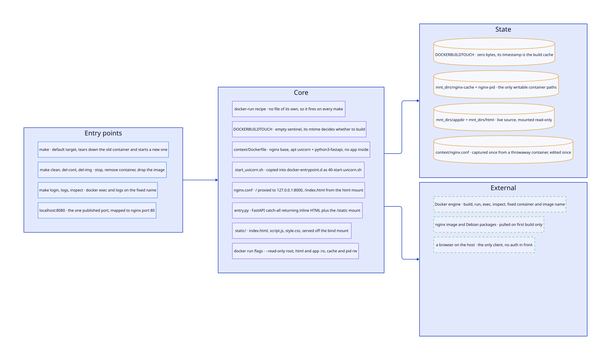

# docker-make-uvicorn — how it works

A template for running nginx in front of a reloading uvicorn/FastAPI app in one container, where `make` is the entire build-and-deploy pipeline: it rebuilds the image only when the context files move, then replaces the running container on port 8080.

Read it left to right:

- **`make` is a deploy loop, not a build system.** The default target ends in `docker run`, and its own file target is never created, so every `make` stops the old container and starts a fresh one. `DOCKERBUILDTOUCH` is an empty file whose mtime is the whole build cache: it is touched after `docker build`, so editing `nginx.conf`, `Dockerfile` or `start_uvicorn.sh` triggers a rebuild and nothing else does. `make clean` is exactly "delete the container and image, then `touch` nginx.conf to force the next rebuild".
- **`nginx.conf` is a captured artifact that became source.** If the file does not exist, the Makefile starts a throwaway `nginx` container and `docker cp`s its stock `nginx.conf` out. The checked-in copy is that snapshot, hand-edited: the working `proxy_pass` points at `127.0.0.1:8000` while the commented `#production` line still wants `unix:/tmp/uvicorn.sock`, and `location = /index.html` is served by nginx itself.
- **uvicorn is a child of nginx, not a sibling.** `start_uvicorn.sh` is copied into `/docker-entrypoint.d/` as `40-start-uvicorn.sh`, so nginx's own entrypoint launches uvicorn in the background with `--reload`, pointing its output at `/proc/1/fd/1` so both servers land in `docker logs`. There is no supervisor and no health check: if uvicorn dies, nginx keeps happily answering 502s.
- **The container is read-only by default.** `--read-only` on the root filesystem, with only `mnt_dirs/nginx-cache` and `mnt_dirs/nginx-pid` writable; the HTML and the Python app are bind-mounted `:ro`. Live editing still works because `--reload` watches the mounted source tree from outside, not because the container can write to it.
- **Routing is three-way, and the module path is a contract.** `/` hits FastAPI's catch-all (which returns HTML as a string), `/static` is FastAPI's `StaticFiles` over `mnt_dirs/appdir/static`, and `/index.html` is nginx reading `mnt_dirs/html`. `autoindex on` exposes that html mount as a file listing. The doubled `n` in `/docker-work/uvicornn/appdir` is also the import name (`uvicornn.appdir.entry`), so the mount target and the module must be renamed together or the app stops booting.

Diagram source: [`docs/system.d2`](docs/system.d2) · render with [`scripts/render-diagram.sh`](scripts/render-diagram.sh) (writes `docs/system.svg` and `docs/system.png`).
